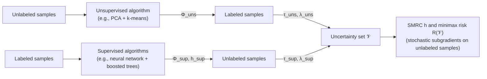

# Leveraging Supervised and Unsupervised Methods for Minimax Semi-supervised Learning

[](https://github.com/MachineLearningBCAM/SMRC/actions/workflows/tests.yml)
[](LICENSE)

This repository contains the code for **semi-supervised minimax risk classifiers (SMRCs)**, presented in

> S. Mazuelas, "Leveraging Supervised and Unsupervised Methods for Minimax Semi-supervised Learning," *Information and Inference: A Journal of the IMA*.

SMRCs can leverage general supervised and unsupervised learning algorithms, and provide performance guarantees that do not rely on specific assumptions about the data distribution or on labeled validation samples. The code is provided both in **Python** and in **MATLAB**.

## Method in a nutshell

SMRCs minimize the worst-case error probability over an uncertainty set of distributions defined by the expectation of a feature mapping $\Phi$ and by the instances' marginal distribution:

$$\min_{\mathrm{h}}\ \max_{\mathrm{p}\in\mathcal{V}}\ \ell(\mathrm{h},\mathrm{p}),\qquad \mathcal{V}=\big\lbrace \mathrm{p}:\ |\mathbb{E}_{\mathrm{p}}\lbrace\Phi\rbrace-\boldsymbol{\tau}|\preceq\boldsymbol{\lambda},\ \mathrm{p}_x=\mathrm{p}_x^*\big\rbrace .$$

The feature mapping and the mean/confidence vectors are obtained from labeled and unlabeled samples using supervised and unsupervised algorithms:



- Unsupervised algorithms learn features $\Phi_\text{uns}$ from unlabeled samples, and their expectations are estimated with the labeled samples.
- Supervised algorithms learn features $\Phi_\text{sup}$ and a classifier $\mathrm{h}_\text{sup}$ from labeled samples, and the expectations of $\Phi_\text{sup}$ are estimated with the unlabeled samples labeled confidently by $\mathrm{h}_\text{sup}$.
- The SMRC parameters are obtained by solving a convex problem with stochastic subgradients computed at unlabeled samples (Algorithm 1 in the paper). The optimal value is the minimax risk $R(\mathcal{V})$, which assesses the classifier's error probability without validation samples.

## Repository structure

```
├── python/                 Python package `smrc`
│   ├── smrc/               SMRC estimator, feature learners, and performance bounds
│   ├── examples/           USPS demo and scripts to reproduce Table 1 and Figure 1
│   └── tests/
├── matlab/                 MATLAB implementation
└── data/usps.mat           USPS dataset (pixel values)
```

## Python

### Installation

```bash
git clone https://github.com/MachineLearningBCAM/SMRC.git
cd SMRC
pip install ./python          # requires numpy, scipy, and scikit-learn
```

### Quick start

```python
import smrc

X, y = smrc.load_mat("data/usps.mat")
lab, unl, test = smrc.partition(y, n_lab=500, n_unl=7000, n_test=1000, random_state=1)

clf = smrc.SMRC(random_state=1)
clf.fit(X[lab], y[lab], X[unl])          # labeled and unlabeled samples

y_pred = clf.predict(X[test])            # deterministic SMRC
proba = clf.predict_proba(X[test])       # randomized SMRC h(y|x)
print("error:", (y_pred != y[test]).mean())
print("minimax risk R(V):", clf.minimax_risk_)

lower, upper = clf.error_bounds(delta=0.05)  # high-confidence bounds (Theorem 6)
```

(The examples standardize the instances before fitting; see `python/examples/usps_demo.py`.)

By default, `SMRC` uses the algorithms in the paper's experiments: principal components and k-means clusters for unsupervised features (`PCAKMeansFeatures`), the first layer of a feedforward neural network for supervised features (`NeuralNetworkFeatures`), and boosted trees as supervised classifier (`ConfidentClassifier`). Any of them can be replaced:

```python
from sklearn.ensemble import RandomForestClassifier

clf = smrc.SMRC(
    unsupervised_features=smrc.AutoencoderFeatures(n_hidden=50, n_clusters=50),
    supervised_features=smrc.NeuralNetworkFeatures(n_hidden=200),
    supervised_classifier=smrc.ConfidentClassifier(RandomForestClassifier(200)),
)
```

Unsupervised feature learners are scikit-learn transformers fitted with unlabeled instances (`fit(X)`/`transform(X)`), supervised feature learners are transformers fitted with labeled samples (`fit(X, y)`/`transform(X)`), and `ConfidentClassifier` wraps any classifier with `predict_proba` and defines the set of confidently classified instances. By default, all instances are taken as confidently classified, which is what the MATLAB code used for the paper's experiments does in practice; `ConfidentClassifier(threshold="cv")` uses instead the threshold obtained by cross-validation described in Section 5.2. Use `supervised_features="none"` or `unsupervised_features="none"` to use only one type of features.

Main attributes after fitting: `mu_` (SMRC parameters), `tau_` and `lambda_` (mean and confidence vectors), `minimax_risk_` ($R(\mathcal{V})$), and `disagreement_` (the term $\mathbb{E}\lbrace\psi(\boldsymbol{\mu}^*,x)\rbrace$ in Theorem 4 bounding the difference between deterministic and randomized SMRCs).

### Examples and reproducibility

```bash
cd python
python examples/usps_demo.py --seed 1 --bounds              # one partition of USPS
python examples/reproduce_table.py ../data/usps.mat --n-unl 7000 --reps 20
python examples/reproduce_figure.py cifar10_resnet18.mat     # requires matplotlib
```

`reproduce_table.py` gives the SMRC, SUP, and $R(\mathcal{V})$ columns of Table 1 for a dataset stored as a `.mat` file with a `d x n` matrix `x` and a label vector `y` (the format of `data/usps.mat`). In the paper, the instances of `MNIST`, `USPS`, and `MNIST4-9` are represented by pixel values, and those of `FashionMNIST`, `CIFAR10`, `STL10`, `YearBook`, and `CatsDogs` by the penultimate layer of a pre-trained ResNet18 network. `reproduce_figure.py` gives Figure 1 (use `--autoencoder` for Figure 1(b)).

The Python implementation follows the MATLAB one. The learning problem is solved with mini-batches of stochastic subgradients: with the default settings (`batch_size=100`, `max_iter=100000`, and step size `0.1 * batch_size / m`), the optimization corresponds to the one in the MATLAB code ($10^7$ single-sample subgradient steps of size $0.1/m$). Results differ slightly from those obtained in MATLAB because the supervised and unsupervised algorithms are those of scikit-learn instead of MATLAB's (e.g., `AdaBoostClassifier` instead of `fitcensemble`).

### Tests

```bash
pip install "./python[test]"
pytest python/tests
```

## MATLAB

Requires the Statistics and Machine Learning Toolbox (R2021a or later); the autoencoder variant also requires the Deep Learning Toolbox.

- `main.m`: runs SMRCs with the settings of Table 1 on one random partition of the `USPS` dataset in `data/`.
- `main_bounds.m`: computes the high-confidence performance bounds of Theorem 6 (as in Figure 1).
- `learn_uns.m`, `learn_uns_autoencoder.m`: unsupervised feature learning with principal component analysis and k-means clustering, or with an autoencoder and k-means clustering.
- `learn_sup.m`: supervised feature learning with a feedforward neural network and supervised classification with boosted trees, including the confidence threshold.
- `compute_phi_uns.m`, `compute_phi_sup.m` (with `feat_uns.m`, `feat_sup.m`): feature mappings $\Phi_\text{uns}$ and $\Phi_\text{sup}$.
- `fit_SMRC.m`: stochastic subgradient method that obtains the SMRC parameters and the minimax risk.
- `subgradient.m`: efficient computation of subgradients (Algorithm 1).
- `predict_SMRC.m`: evaluates SMRCs (randomized and deterministic) at an instance.
- `performance_bounds.m`, `confidence_interval.m`: performance bounds of Theorem 6 using confidence intervals obtained by betting.

## Citation

```bibtex
@article{Maz:26,
  author  = {Mazuelas, Santiago},
  title   = {Leveraging Supervised and Unsupervised Methods for Minimax Semi-supervised Learning},
  journal = {Information and Inference: A Journal of the IMA},
  year    = {2026}
}
```

## License

MIT (see [LICENSE](LICENSE)).
